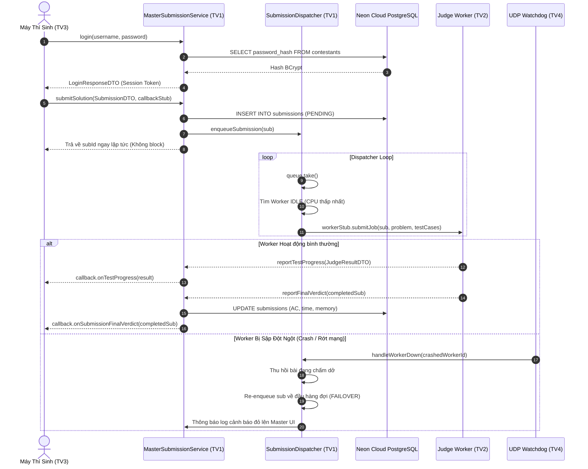

# 📘 KẾ HOẠCH TRIỂN KHAI CHI TIẾT – THÀNH VIÊN 1 (TV1)
## MASTER RMI SERVER, NEON POSTGRESQL & SUBMISSION DISPATCHER (AUTO-FAILOVER)

> **Họ và tên thành viên:** *[Điền tên thành viên 1]*  
> **Vai trò chuyên trách:** Master Node Core Architect & Database Administrator  
> **Git Branch:** `feat/member1-master-neondb`  
> **Giao thức chính:** Java RMI (`IMasterSubmissionService`, `IMasterClusterService`), JDBC/HikariCP SSL, Multi-threading Producer-Consumer (`LinkedBlockingQueue`).

---

## 1. PHẠM VI TRÁCH NHIỆM & CÁC FILE SỞ HỮU (OWNER FILES)

Thành viên 1 chịu trách nhiệm toàn quyền trên các package sau:

```
PulseOJ/
├── backend/src/main/java/com/vku/pulseoj/backend/
│   ├── db/
│   │   ├── NeonDataSourceConfig.java       # Quản lý HikariCP Connection Pool & Auto Schema Migration
│   │   ├── ContestantAccountDAO.java       # CRUD tài khoản thí sinh, BCrypt hash, khóa/mở khóa
│   │   ├── ProblemDAO.java                 # CRUD đề thi và bộ TestCase (Sample & Hidden)
│   │   └── SubmissionDAO.java              # Lưu bài nộp và cập nhật kết quả chấm từ Worker
│   └── master/
│       ├── MasterBackendController.java    # Bộ điều khiển Master, vòng đời RMI Registry & UDP
│       ├── MasterSubmissionServiceImpl.java# RMI Service cho Client (Auth, Nộp bài, Bảng điểm)
│       ├── MasterClusterServiceImpl.java   # RMI Service cho Worker (Đăng ký node, Báo tiến độ test)
│       ├── SubmissionDispatcher.java       # LinkedBlockingQueue + Điều phối Worker + Auto-Failover
│       └── MasterUiListener.java           # Interface đẩy dữ liệu từ Backend lên giao diện Master
└── frontend/src/main/java/com/vku/pulseoj/frontend/
    ├── MasterAppLauncher.java              # Điểm khởi chạy ứng dụng Máy Giáo Viên
    └── ui/master/
        ├── MasterMainFrame.java            # Cửa sổ chính máy Giáo viên (Tab TV1 + Tab TV4)
        ├── ContestantManagementPanel.java  # UI Quản lý tài khoản thí sinh trên Neon DB
        ├── ProblemManagementPanel.java     # UI Quản lý đề bài & thêm bộ Test Case ẩn
        └── SubmissionQueuePanel.java       # UI Giám sát hàng đợi bài nộp thời gian thực
```

---

## 2. KIẾN TRÚC LUỒNG DỮ LIỆU & SƠ ĐỒ TUẦN TỰ (SEQUENCE DIAGRAM)



---

## 3. TRIỂN KHAI KỸ THUẬT CHI TIẾT TỪNG MODULE

### 3.1. Phân hệ Database Neon Cloud (`backend.db`)

#### Lớp `NeonDataSourceConfig.java`
* **Mục đích:** Khởi tạo connection pool tới Neon Serverless PostgreSQL với giao thức SSL bắt buộc (`sslmode=require`). Cung cấp cơ chế tự động chạy file `schema.sql` và chế độ Mock Mode chạy offline nếu không có mạng.
* **Cấu hình HikariCP tối ưu cho Serverless:**
  ```java
  config.setMaximumPoolSize(10);
  config.setMinimumIdle(2);
  config.setIdleTimeout(30000);        // 30s giải phóng kết nối nhàn rỗi (tiết kiệm Neon compute hours)
  config.setMaxLifetime(600000);       // 10 phút làm mới kết nối
  config.setConnectionTimeout(10000);  // 10s chờ kết nối
  config.addDataSourceProperty("sslmode", "require");
  ```
* **Nhiệm vụ cần làm thêm:**
  1. Đọc biến môi trường an toàn qua `io.github.cdimascio.dotenv.Dotenv`.
  2. Xây dựng hàm kiểm tra kết nối `testConnection()` khi mở ứng dụng để báo đèn xanh/vàng lên thanh trạng thái của Master UI.

#### Lớp `ContestantAccountDAO.java`
* **Mục đích:** Quản lý toàn bộ vòng đời tài khoản thí sinh do Giáo viên tạo trên Neon DB.
* **Các phương thức bắt buộc hoàn thiện:**
  - `ContestantDTO authenticate(String username, String rawPassword)`: Truy vấn DB, kiểm tra `is_locked == false`, dùng `BCrypt.checkpw(rawPassword, storedHash)` đối chiếu.
  - `ContestantDTO createContestant(String username, String rawPassword, String fullName)`: Băm mật khẩu `BCrypt.hashpw(rawPassword, BCrypt.gensalt(10))` và `INSERT`.
  - `boolean setLockStatus(int contestantId, boolean locked)`: Khóa hoặc mở khóa tài khoản tức thì. Thí sinh bị khóa sẽ không thể nộp bài tiếp.
  - `List<ContestantDTO> getAllContestants()`: Lấy danh sách hiển thị lên bảng Master.

#### Lớp `ProblemDAO.java` & `SubmissionDAO.java`
* **Nhiệm vụ:**
  - `ProblemDAO`: Lưu trữ đề thi, giới hạn `time_limit_ms`, `memory_limit_mb` và danh sách `test_cases`. Lưu ý phương thức `getProblemById(int problemId, boolean includeHidden)`: Khi Client lấy đề thì `includeHidden = false` (chỉ trả về sample test); khi Master dispatch bài cho Worker chấm thì `includeHidden = true` (lấy toàn bộ test ẩn).
  - `SubmissionDAO`: `saveSubmission` (lưu trạng thái `PENDING`) và `updateVerdict` (cập nhật kết quả `AC`, `WA`, `TLE`, `RE`, `CE`, thời gian chạy `execution_time_ms`, RAM sử dụng, và ID máy chấm `worker_id`).

---

### 3.2. Phân hệ Điều phối & Hàng đợi Chịu lỗi (`backend.master`)

#### Lớp `SubmissionDispatcher.java`
* **Mục đích:** Trái tim điều phối chịu tải của hệ thống.
* **Cấu trúc dữ liệu nền tảng:**
  - `BlockingQueue<SubmissionDTO> queue = new LinkedBlockingQueue<>()`: Hàng đợi bài nộp thread-safe.
  - `Map<String, WorkerSession> activeWorkers = new ConcurrentHashMap<>()`: Quản lý các Worker đang kết nối và trạng thái (`IDLE`, `BUSY`, `OFFLINE`).
  - `Map<Integer, SubmissionDTO> inFlightTasks = new ConcurrentHashMap<>()`: Lưu vết bài nộp đang được chấm trên từng máy.
  - `Map<Integer, String> taskToWorkerMap = new ConcurrentHashMap<>()`: Ánh xạ `submissionId -> workerId`.
* **Luồng xử lý `run()` của Dispatcher:**
  ```java
  while (running) {
      SubmissionDTO sub = queue.take(); // Block an toàn, không tốn CPU
      WorkerSession bestWorker = pickBestIdleWorker();
      if (bestWorker != null) {
          dispatchJobToWorker(bestWorker, sub);
      } else {
          // Chưa có Worker rảnh -> Re-queue và chờ tín hiệu
          queue.offer(sub);
          Thread.sleep(300);
      }
  }
  ```
* **Thuật toán Chọn Worker Tối ưu (`pickBestIdleWorker`):**
  - Ưu tiên 1: Trạng thái phải là `WorkerStatus.IDLE`.
  - Ưu tiên 2: Tải `% CPU` thấp nhất (dựa trên thông số telemetry do TV4 thu thập).
* **Cơ chế Tự Động Chịu Lỗi (`Auto-Failover`):**
  - Hàm `handleWorkerDown(String deadWorkerId)`:
    1. Kiểm tra trong `taskToWorkerMap` xem Worker bị sập có đang xử lý bài nào dở dang không.
    2. Nếu có, lập tức thu hồi đối tượng `SubmissionDTO` từ `inFlightTasks`.
    3. Đặt lại trạng thái `submission.setVerdict(Verdict.PENDING)`.
    4. Đưa bài nộp này quay trở lại **đầu hàng đợi** để ưu tiên gán cho Worker khác chấm lại ngay.
    5. Đẩy thông báo cảnh báo đỏ lên màn hình Giáo viên: `FAILOVER: Re-queued submission #1024 (Worker-B died)`.

#### Lớp `MasterSubmissionServiceImpl.java` & `MasterClusterServiceImpl.java`
* Triển khai đầy đủ các phương thức RMI:
  - `submitSolution`: Lưu DB -> Đẩy vào `queue` -> Trả về kết quả sau vài mili-giây.
  - `reportTestProgress`: Nhận từ Worker -> Chuyển tiếp tới đúng Callback của thí sinh nộp bài.
  - `reportFinalVerdict`: Cập nhật DB -> Báo Client nộp bài hoàn tất -> Gọi `broadcastScoreboard()` cập nhật Bảng xếp hạng cho toàn phòng thi.

---

### 3.3. Phân hệ Giao diện Master UI (`frontend.ui.master`)

1. **Tab "Quản lý Thí sinh (Neon DB)":** Bảng hiển thị danh sách tài khoản, nút tạo mới với Dialog nhập Username/Password, nút Khóa/Mở khóa.
2. **Tab "Quản lý Đề bài & Test Case":** Tạo đề bài mới, nhập Time Limit (ms), Memory Limit (MB), thêm Test Case (đánh dấu test mẫu hay test ẩn).
3. **Tab "Hàng đợi Bài nộp Thời gian thực":** Bảng hiển thị toàn bộ bài nộp với màu sắc trạng thái rõ ràng (Xanh: AC, Đỏ: WA/TLE/RE/CE, Vàng: PENDING, Xanh dương: RUNNING).

---

## 4. KỊCH BẢN KIỂM THỬ & TRẢ LỜI CÂU HỎI BẢO VỆ (ĐIỂM A+)

### Kịch bản Demo thực tế:
1. **Demo tạo tài khoản:** Trên Master UI, bấm tạo tài khoản `team_01` / `vku@2026`. Mở console Neon PostgreSQL chứng minh mật khẩu đã được mã hóa BCrypt (`$2a$10$...`), không lộ mật khẩu gốc.
2. **Demo nộp bài đồng thời:** Dùng công cụ Stress Test của TV4 bắn 20 bài cùng lúc. Chứng minh trên Tab Hàng đợi của TV1: 20 bài lập tức vào hàng đợi `PENDING`, sau đó chuyển dần sang `RUNNING` trên các Worker và hoàn thành sạch sẽ không rớt bài nào.
3. **Demo Auto-Failover:** Cho Worker đang chấm 1 bài 10 test case. Đến test 5, bấm nút sập Worker ở máy của TV2. Hội đồng sẽ thấy trên máy Giáo viên xuất hiện dòng chữ đỏ: `FAILOVER: Worker-01 crashed. Re-queueing sub #...`, và bài nộp tự động chuyển sang Worker-02 chấm tiếp mà thí sinh không hề bị mất kết quả!

### Các câu hỏi lý thuyết giảng viên thường hỏi TV1:
* **Hỏi:** *Tại sao chỉ có Master Server mới kết nối trực tiếp vào Neon Database?*  
  **Trả lời:** *Đây là kiến trúc 3 tầng (3-Tier Architecture) bảo mật. Nếu để Client hoặc Worker kết nối thẳng vào DB, ta phải phân phối chuỗi kết nối kèm mật khẩu DB tới từng máy trạm, rất dễ bị thí sinh trích xuất mã nguồn để hack đề thi hoặc xem trước bộ test ẩn. Master đóng vai trò Gateway duy nhất kiểm soát mọi quyền truy cập.*
* **Hỏi:** *Hàng đợi `LinkedBlockingQueue` có ưu điểm gì so với `ArrayList` hay `LinkedList` thông thường?*  
  **Trả lời:** *`LinkedBlockingQueue` là cấu trúc dữ liệu an toàn luồng (Thread-safe) sử dụng hai khóa độc lập (`takeLock` và `putLock`). Phương thức `take()` tự động block luồng khi hàng đợi rỗng và tự đánh thức khi có bài nộp mới mà không tốn chu kỳ CPU (Zero CPU Busy-waiting).*
