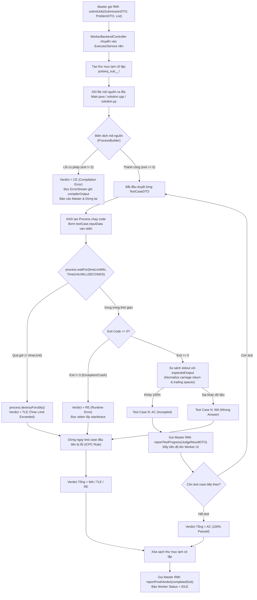

# 📘 KẾ HOẠCH TRIỂN KHAI CHI TIẾT – THÀNH VIÊN 2 (TV2)
## JUDGE WORKER RMI NODE & CODE SANDBOX EXECUTION ENGINE (`PROCESSBUILDER`)

> **Họ và tên thành viên:** *[Điền tên thành viên 2]*  
> **Vai trò chuyên trách:** Judge Worker Node Architect & Security Sandbox Engineer  
> **Git Branch:** `feat/member2-worker-sandbox`  
> **Giao thức chính:** Java RMI (`IJudgeWorkerService`), Hệ thống tiến trình OS (`java.lang.ProcessBuilder`), I/O Stream Piping, CPU Time-Limit Enforcement.

---

## 1. PHẠM VI TRÁCH NHIỆM & CÁC FILE SỞ HỮU (OWNER FILES)

Thành viên 2 chịu trách nhiệm toàn quyền trên các package sau:

```
PulseOJ/
├── backend/src/main/java/com/vku/pulseoj/backend/
│   └── worker/
│       ├── JudgeWorkerServiceImpl.java     # Cài đặt RMI Service nhận bài chấm từ Master
│       ├── CodeSandboxExecutor.java        # Hộp cát ProcessBuilder biên dịch & chạy cô lập mã nguồn
│       ├── WorkerBackendController.java    # Điều phối kết nối cụm, đăng ký node & giả lập sập máy
│       └── WorkerUiListener.java           # Interface đẩy thông số console & tiến trình lên Worker UI
└── frontend/src/main/java/com/vku/pulseoj/frontend/
    ├── WorkerAppLauncher.java              # Điểm khởi chạy ứng dụng Máy Chấm
    └── ui/worker/
        └── WorkerMainFrame.java            # Giao diện hộp cát máy chấm, tiến trình test & nút Simulate Crash
```

---

## 2. KIẾN TRÚC HỘP CÁT CÔ LẬP & LUỒNG THỰC THI (SANDBOX PIPELINE)



---

## 3. TRIỂN KHAI KỸ THUẬT CHI TIẾT

### 3.1. Phân hệ Biên dịch & Thực thi Đa ngôn ngữ (`CodeSandboxExecutor.java`)

#### Thiết lập Môi trường Cô Lập
* Sử dụng `Files.createTempDirectory("pulseoj_sub_" + submission.getId() + "_")` để mỗi bài nộp có một không gian đĩa riêng, không bị xung đột tên file `Main.class` khi chấm song song.
* Tự động xóa sạch thư mục tạm trong khối `finally { cleanupDirectory(sandboxDir); }` bằng `Files.walk()`.

#### Lệnh Biên dịch & Chạy cho từng Ngôn ngữ:
1. **Java (`Language.JAVA`):**
   - Biên dịch: `new ProcessBuilder("javac", "Main.java")`
   - Thực thi: `new ProcessBuilder("java", "-Xmx256m", "Main")` (giới hạn Heap tối đa 256MB).
2. **C++ (`Language.CPP`):**
   - Biên dịch: `new ProcessBuilder("g++", "-O2", "solution.cpp", "-o", exeName)`
   - Thực thi: `new ProcessBuilder("./" + exeName)`
3. **Python (`Language.PYTHON`):**
   - Kiểm tra cú pháp (Syntax Check): `new ProcessBuilder("python", "-m", "py_compile", "solution.py")`
   - Thực thi: `new ProcessBuilder("python", "solution.py")`

#### Xử lý Luồng Dữ liệu I/O (Piping Stdin & Stdout):
* **Bơm dữ liệu đầu vào:**
  ```java
  try (OutputStream os = process.getOutputStream()) {
      os.write(inputData.getBytes(StandardCharsets.UTF_8));
      os.flush();
  }
  ```
* **Đọc kết quả đầu ra:** Đọc `process.getInputStream()` trên luồng `StandardCharsets.UTF_8`.
* **Thuật toán Chuẩn Hóa & So Sánh (Output Normalization):**
  - Chuyển toàn bộ dấu xuống dòng kiểu Windows `\r\n` về kiểu Unix `\n`.
  - Cắt bỏ khoảng trắng và dòng trống dư thừa ở cuối file (`trim()` / `replaceAll("\\s+$", "")`).
  - Nếu kết quả khớp 100% ➔ `Verdict.AC`; nếu khác biệt dù chỉ 1 ký tự ➔ `Verdict.WA`.

#### Cơ chế Cắt Tiến trình Quá giờ (`Time Limit Enforcement`):
* Mã nguồn thí sinh có thể chứa vòng lặp vô hạn `while(true)`. Worker bắt buộc phải tiêu diệt tiến trình:
  ```java
  boolean completedInTime = process.waitFor(timeLimitMs + 300, TimeUnit.MILLISECONDS);
  if (!completedInTime) {
      process.destroyForcibly(); // Tiêu diệt tiến trình con ngay lập tức
      return new TestRunResult(true, -1, "", "Time Limit Exceeded", elapsed, 0);
  }
  ```

#### Chế độ Trình diễn Chậm (`Demo Slow Mode`):
* Khi đi thi bảo vệ, thêm cờ `demoSlowMode = true`: Sau mỗi test case, luồng nghỉ `Thread.sleep(400)`.
* **Tác dụng:** Giúp hội đồng nhìn thấy thanh tiến trình trên cả máy Worker và máy Client nhảy từng test 1 ➔ 2 ➔ 3... một cách trực quan, thay vì chạy vèo 0.1 giây là xong.

---

### 3.2. Cài đặt RMI Service Máy chấm (`JudgeWorkerServiceImpl.java`)

* Kế thừa `UnicastRemoteObject` và cài đặt interface `IJudgeWorkerService`.
* **Nguyên tắc không chặn RMI (Non-blocking RMI):** Khi Master gọi `submitJob(...)`, hàm này lập tức đẩy tác vụ vào `ExecutorService threadPool = Executors.newSingleThreadExecutor()` và trả về ngay để Master không bị treo.
* Trong luồng thực thi nền:
  1. Đổi trạng thái máy sang `WorkerStatus.BUSY`.
  2. Cập nhật `heartbeatSender.setStatus(WorkerStatus.BUSY)`.
  3. Chạy từng test case qua `CodeSandboxExecutor`.
  4. Mỗi test chạy xong, gọi RMI ngược lên Master: `masterClusterService.reportTestProgress(result)`.
  5. Khi toàn bộ test case hoàn tất, gọi `masterClusterService.reportFinalVerdict(completedSub)`.
  6. Đổi trạng thái máy trở về `WorkerStatus.IDLE` để sẵn sàng nhận bài mới.

---

### 3.3. Tính năng Giả Lập Sập Máy Chấm (`simulateCrash()`)

* **Nằm trong:** `WorkerBackendController.java`.
* **Cách thức hoạt động:**
  ```java
  public synchronized void simulateCrash() {
      // 1. Dừng ngay lập tức việc bắn nhịp tim UDP 8889
      if (heartbeatSender != null) heartbeatSender.stop();
      // 2. Hủy đăng ký đối tượng RMI (Cắt kết nối TCP từ xa)
      if (workerService != null) {
          UnicastRemoteObject.unexportObject(workerService, true);
          workerService.shutdown();
      }
      isConnected = false;
      // 3. Đổi giao diện sang OFFLINE
      if (uiListener != null) uiListener.onWorkerStatusChanged(WorkerStatus.OFFLINE);
  }
  ```
* **Mục đích:** Khi người dùng bấm nút đỏ **"🛑 Giả Lập Sập Máy Chấm (Kill Worker)"**, máy chấm này lập tức "chết" mô phỏng việc bị rút phích cắm nguồn. Master sẽ phát hiện mất nhịp tim hoặc nhận `RemoteException` để kích hoạt cơ chế tự động chuyển bài nộp (Auto-Failover).

---

### 3.4. Giao diện Máy chấm (`WorkerMainFrame.java`)

* **Thanh kết nối cụm:** Ô nhập IP/Port của Master, nút **"Auto-Discover (UDP 8888)"** tự động tìm Master không cần gõ IP, nút **"Connect to Master"**, và nút đỏ **"Simulate Crash"**.
* **Đèn báo trạng thái:** `🟢 IDLE` (Xanh lá), `🟠 BUSY` (Xanh dương), `🔴 OFFLINE` (Đỏ).
* **Thanh tiến trình Test Case:** Hiển thị phần trăm và số test đang chấm (Ví dụ: `Running Test 4 / 10 (40%)`).
* **Hộp Console đen (`ProcessBuilder Output Console`):** Hiển thị trực tiếp log lệnh biên dịch, luồng stdout/stderr, mã lỗi trả về của hệ điều hành.

---

## 4. KỊCH BẢN DEMO BẢO VỆ ĐỒ ÁN (ĐIỂM A+)

1. **Demo tự động nhận diện Master:** Bật ứng dụng Worker trên Laptop 2. Bấm nút **"Auto-Discover"** ➔ Trong 1 giây, ô Host tự điền IP của Laptop 1 (`192.168.1.x`) và tự động kết nối thành công.
2. **Demo chấm bài và hiển thị Console:** Nộp 1 bài đúng ➔ Console hiện chi tiết: `javac Main.java -> OK -> Running test 1... AC -> test 2... AC -> Final: ACCEPTED`.
3. **Demo bắt lỗi TLE:** Thí sinh nộp bài chứa `while(true)` ➔ Đúng 1000ms, console Worker hiện `Time Limit Exceeded -> Destroying process forcibly -> Verdict: TLE`.
4. **Demo phối hợp Sập máy chấm:** Bật Chế độ Demo Chậm (400ms/test). Khi Worker đang chấm đến Test thứ 4, bấm ngay nút **"Simulate Crash"**. Worker lập tức chuyển sang màu đỏ. Quay sang màn hình Master của TV1, chứng minh bài nộp đó không hề bị mất mà đã được thu hồi và tự động chuyển sang Worker khác chấm hoàn thành!

### Câu hỏi lý thuyết giảng viên thường hỏi TV2:
* **Hỏi:** *Tại sao lại dùng `ProcessBuilder` thay vì dùng `Runtime.getRuntime().exec()`?*  
  **Trả lời:** *`ProcessBuilder` ra đời từ Java 5 thay thế cho `Runtime.exec()`, cho phép quản lý môi trường làm việc tốt hơn, thiết lập thư mục làm việc riêng biệt (`directory()`), hỗ trợ cấu hình chuyển hướng luồng I/O linh hoạt và kiểm soát mã thoát (`exitValue()`) an toàn hơn.*
* **Hỏi:** *Nếu mã nguồn thí sinh nộp gọi lệnh độc hại như `System.exit(0)` hoặc xóa file thì hộp cát xử lý thế nào?*  
  **Trả lời:** *Vì code thí sinh được biên dịch và chạy trong một tiến trình Hệ điều hành con hoàn toàn độc lập (Child Process) thông qua `ProcessBuilder`, nếu code gọi `System.exit(0)`, chỉ có tiến trình con đó kết thúc với exit code 0 mà không làm ảnh hưởng đến tiến trình JVM của Worker đang chạy. Ngoài ra, code chỉ được thực thi trong thư mục tạm riêng biệt.*
