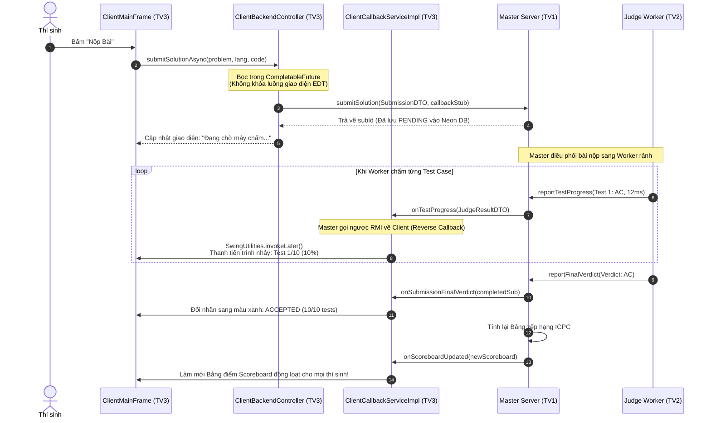

# 📘 KẾ HOẠCH TRIỂN KHAI CHI TIẾT – THÀNH VIÊN 3 (TV3)
## CONTESTANT CLIENT, BI-DIRECTIONAL RMI CALLBACK & LIVE ACM-ICPC SCOREBOARD

> **Họ và tên thành viên:** *[Bạn đảm nhiệm]*  
> **Vai trò chuyên trách:** Contestant Client Experience & Real-time RMI Callback Engineer  
> **Git Branch:** `feat/member3-client-callback`  
> **Quy chuẩn mã nguồn & chữ ký hàm:** [rule/MEMBER_3_CLIENT_RULES.md](file:///d:/Users/BT/N3_K1/LTrMang/PulseOJ/rule/MEMBER_3_CLIENT_RULES.md) | [rule/GENERAL_SYNTAX_RULES.md](file:///d:/Users/BT/N3_K1/LTrMang/PulseOJ/rule/GENERAL_SYNTAX_RULES.md)  
> **Giao thức chính:** Java RMI 2 chiều (Bi-directional RMI / Reverse Callback `IClientCallbackService`), `CompletableFuture` Non-blocking UI, Thuật toán xếp hạng ACM-ICPC, RSyntaxTextArea Editor.

---

## 1. PHẠM VI TRÁCH NHIỆM & CÁC FILE SỞ HỮU (OWNER FILES)

Thành viên 3 chịu trách nhiệm toàn quyền trên các package sau:

```
PulseOJ/
├── backend/src/main/java/com/vku/pulseoj/backend/
│   └── client/
│       ├── ClientCallbackServiceImpl.java  # UnicastRemoteObject nhận dữ liệu đẩy từ Master
│       ├── IcpcScoreboardCalculator.java   # Thuật toán tính điểm & Penalty chuẩn ACM-ICPC (20p/lần sai)
│       ├── ClientBackendController.java    # Bọc mọi lệnh gọi RMI trong CompletableFuture
│       └── ClientUiListener.java           # Interface đẩy kết quả test & bảng xếp hạng lên màn hình
└── frontend/src/main/java/com/vku/pulseoj/frontend/
    ├── ClientAppLauncher.java              # Điểm khởi chạy ứng dụng Máy Thí Sinh
    └── ui/client/
        ├── LanDiscoveryLoginDialog.java    # Hộp thoại quét LAN & Đăng nhập tài khoản Neon DB
        ├── ClientMainFrame.java            # Không gian làm bài 3 cột (Đề bài | Code Editor | Live Feed)
        └── ScoreboardPanel.java            # Bảng xếp hạng trực tiếp ACM-ICPC đổi màu thời gian thực
```

---

## 2. KIẾN TRÚC GIAO TIẾP RMI 2 CHIỀU (REVERSE RMI CALLBACK)



---

## 3. TRIỂN KHAI KỸ THUẬT CHI TIẾT

### 3.1. Đối tượng Nhận Phản Hồi Từ Xa (`ClientCallbackServiceImpl.java`)

* **Bản chất kỹ thuật:** Để Master Server có thể gọi ngược hàm về Client qua mạng LAN, lớp này **bắt buộc phải kế thừa `UnicastRemoteObject`** và cài đặt `IClientCallbackService`:
  ```java
  public class ClientCallbackServiceImpl extends UnicastRemoteObject implements IClientCallbackService {
      public ClientCallbackServiceImpl() throws RemoteException {
          super(); // Export đối tượng trên cổng TCP ẩn danh (Anonymous Port)
      }
  }
  ```
* **Các hàm nhận Push trực tiếp từ Master:**
  1. `onTestProgress(JudgeResultDTO result)`: Nhận thông báo mỗi khi 1 test case chạy xong. Gọi `uiListener.onTestProgress(result)`.
  2. `onSubmissionFinalVerdict(SubmissionDTO submission)`: Nhận kết quả chung cuộc (`AC`, `WA`, `TLE`, `RE`, `CE`) kèm thời gian chạy và bộ nhớ tiêu thụ.
  3. `onScoreboardUpdated(List<ScoreboardRowDTO> scoreboard)`: Nhận danh sách xếp hạng mới khi có bất kỳ bài nào vừa giải đúng trong phòng thi.
  4. `onSystemBroadcast(String message)`: Nhận thông báo khẩn từ Giáo viên (Ví dụ: "Còn 15 phút nữa hết giờ làm bài!").
* **Quy tắc an toàn luồng (Thread-safety):** Do các phương thức trên được thực thi trên luồng RMI Worker Thread của Java, khi cập nhật lên Swing components **bắt buộc 100% phải bọc trong `SwingUtilities.invokeLater(() -> { ... })`**.

---

### 3.2. Thuật toán Xếp hạng Chuẩn Quốc tế ACM-ICPC (`IcpcScoreboardCalculator.java`)

* **Luật tính điểm ACM-ICPC:**
  1. **Thứ hạng:** Ưu tiên số bài giải được (`Solved Count`) cao nhất xếp trên. Nếu bằng số bài, đội có tổng thời gian phạt (`Total Penalty`) nhỏ hơn sẽ xếp trên.
  2. **Thời gian nộp bài (`Solved Time`):** Số phút tính từ lúc bắt đầu kỳ thi cho đến thời điểm nộp bài được chấp nhận (`AC`).
  3. **Điểm phạt (`Penalty`):** Mỗi lần nộp bài bị từ chối (`WA`, `TLE`, `RE`) trước khi giải đúng sẽ bị **cộng thêm 20 phút phạt**.
  4. **Các trường hợp đặc biệt:**
     - Các lần nộp sau khi đã `AC` bài đó sẽ bị bỏ qua hoàn toàn.
     - Nếu một bài nộp sai nhiều lần nhưng **chưa bao giờ giải đúng (`AC`)**, số lần nộp sai đó **không bị tính vào tổng điểm phạt**.
     - Lỗi biên dịch (`CE - Compilation Error`) theo chuẩn ICPC quốc tế **không bị tính điểm phạt**.

* **Ký hiệu hiển thị trên ô bài tập (Scoreboard Cell):**
  - Ô xanh lá: `+` (Giải đúng ngay lần đầu) hoặc `+2 (45m)` (Giải đúng ở lần thứ 3 sau 2 lần sai, giải được ở phút thứ 45).
  - Ô đỏ: `-3` (Đã nộp sai 3 lần và chưa giải được).
  - Ô vàng: `? (1)` (Đang có bài nộp chờ chấm).
  - Dấu chấm `.`: Chưa nộp bài nào.

---

### 3.3. Bộ Điều Khiển Bất Đồng Bộ (`ClientBackendController.java`)

* **Nguyên tắc không bao giờ đơ giao diện:** Toàn bộ các thao tác gọi RMI lên Master đều được bọc trong `CompletableFuture.supplyAsync(...)` chạy trên Thread Pool ngầm:
  ```java
  public CompletableFuture<SubmissionDTO> submitSolutionAsync(ProblemDTO problem, Language lang, String code) {
      return CompletableFuture.supplyAsync(() -> {
          // Lệnh gọi RMI qua mạng (có thể mất vài giây nếu mạng lag)
          return masterService.submitSolution(sub, callbackService);
      }, networkExecutor);
  }
  ```
* **Quản lý phiên làm việc:** Lưu trữ đối tượng `ContestantDTO` hiện tại sau khi đăng nhập thành công để tự động đính kèm `contestantId` vào mỗi lần nộp bài.

---

### 3.4. Giao diện Không Gian Làm Bài 3 Cột (`ClientMainFrame.java`)

* **Cột 1 (Trái): Đề bài & Bộ Test Mẫu:**
  - `JComboBox` chọn đề thi (`TWO_SUM`, `FACTORIAL`,...).
  - Nhãn hiển thị Giới hạn thời gian (Time Limit ms) và Giới hạn bộ nhớ (Memory Limit MB).
  - Khung đọc đề bài có hỗ trợ cuộn văn bản.
  - Bảng hiển thị Test Case mẫu (`Sample Input` / `Sample Output`).
* **Cột 2 (Giữa): Trình soạn thảo mã nguồn `RSyntaxTextArea`:**
  - Hỗ trợ tô màu cú pháp (Syntax Highlighting) chuyên nghiệp cho 3 ngôn ngữ: `Java`, `C++`, `Python`.
  - Nút **"Reset Template"**: Tự động chèn khung code chuẩn (ví dụ `Scanner` đọc dữ liệu cho Java, `ios_base::sync_with_stdio` cho C++).
  - Nút bấm to màu xanh lá: **"Submit Solution"**.
* **Cột 3 (Phải): Tiến trình Chấm bài & Lịch sử:**
  - Thanh tiến trình `JProgressBar` chạy phần trăm và số test case.
  - Bảng kết quả từng test: Cứ mỗi test chạy xong nhảy thêm 1 dòng hiển thị màu xanh (`AC`) hoặc đỏ (`WA`/`TLE`/`RE`) kèm mili-giây.
  - Bảng lịch sử các lần nộp bài trước đó của thí sinh.
* **Tab "Live ACM-ICPC Scoreboard":**
  - Hiển thị bảng tổng sắp toàn phòng thi. Tự động đổi màu và cập nhật thứ hạng ngay tức khắc khi có thông báo broadcast từ Master.

---

## 4. KỊCH BẢN DEMO BẢO VỆ ĐỒ ÁN (ĐIỂM A+)

1. **Demo Quét LAN & Đăng nhập:** Bật ứng dụng Client trên Laptop 4. Bấm **"Auto-Discover"** ➔ Tự nhận diện Master `192.168.1.x`. Đăng nhập tài khoản `student01` / `password123`.
2. **Demo Trình Soạn Thảo & Nộp Code:** Chọn ngôn ngữ C++, gõ code giải bài `TWO_SUM`. Bấm **Submit** ➔ Quan sát Cột 3: Thanh tiến trình nhảy mượt mà: `Test 1 AC -> Test 2 AC -> Test 3 AC -> Final: ACCEPTED`.
3. **Demo Kiểm Chứng RMI Callback vs Polling:** Khi giảng viên hỏi về cơ chế mạng, giải thích: *"Thưa thầy, máy Client không hề gửi bất kỳ request hỏi vòng nào sau khi nộp bài. Cột tiến trình nhảy được là do Master chủ động gọi hàm `onTestProgress` thông qua RMI Callback Stub của Client."*
4. **Demo Bảng Điểm ICPC:** Mở Tab Scoreboard. Nộp một bài sai để chứng minh xuất hiện ô đỏ `-1` nhưng chưa bị cộng Penalty. Sau đó sửa lại code đúng và nộp ➔ Ô chuyển sang màu xanh lá `+1 (x phút)`, tổng điểm phạt tự động cộng thêm đúng 20 phút phạt theo chuẩn thi quốc tế!

### Câu hỏi lý thuyết giảng viên thường hỏi TV3:
* **Hỏi:** *Tại sao trong Java RMI cần dùng `UnicastRemoteObject` cho cả Client khi làm tính năng Callback?*  
  **Trả lời:** *Thông thường Client chỉ giữ Stub của Server. Nhưng để Server có thể gọi ngược lại Client (Server Push), Client phải xuất khẩu (export) một đối tượng từ xa kế thừa `UnicastRemoteObject` để mở một listening port trên máy Client. Server sẽ lưu Stub của đối tượng này và gọi hàm từ xa xuống Client như một Remote Object thông thường.*
* **Hỏi:** *Nếu mạng giữa chừng bị ngắt hoặc thí sinh tắt Client thì Master có bị treo khi gọi Callback không?*  
  **Trả lời:** *Không, vì ở phía Master Server, khi duyệt danh sách các Callback, ta luôn bọc trong khối `try-catch (RemoteException e)`. Nếu Client bị mất kết nối, Master sẽ bắt ngoại lệ này và tự động xóa Stub của Client đó khỏi `ConcurrentHashMap` để dọn dẹp kết nối chết.*
