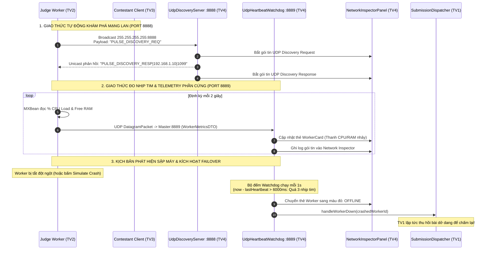

# 📘 KẾ HOẠCH TRIỂN KHAI CHI TIẾT – THÀNH VIÊN 4 (TV4)
## LAN AUTO-DISCOVERY (UDP 8888), HEARTBEAT TELEMETRY (UDP 8889) & CLUSTER MONITOR

> **Họ và tên thành viên:** *[Điền tên thành viên 4]*  
> **Vai trò chuyên trách:** Network Protocols Specialist, UDP Telemetry & Cluster Monitor Architect  
> **Git Branch:** `feat/member4-udp-monitor`  
> **Giao thức chính:** UDP Broadcast (`255.255.255.255:8888`), UDP DatagramSocket Unicast (Port `8889`), Java Management Extensions (`OperatingSystemMXBean`), Network Packet Interception.

---

## 1. PHẠM VI TRÁCH NHIỆM & CÁC FILE SỞ HỮU (OWNER FILES)

Thành viên 4 chịu trách nhiệm toàn quyền trên các package sau:

```
PulseOJ/
├── backend/src/main/java/com/vku/pulseoj/backend/
│   └── discovery/
│       ├── UdpDiscoveryServer.java         # Lắng nghe UDP 8888 trên Master, phản hồi IP LAN thực
│       ├── UdpDiscoveryClient.java         # Bắn UDP Broadcast 255.255.255.255 để tìm Master trong 2 giây
│       ├── UdpHeartbeatSender.java         # Thu thập % CPU, RAM trống qua MXBean và bắn UDP 8889 mỗi 2s
│       ├── UdpHeartbeatWatchdog.java       # Canh gác nhịp tim trên Master, phát hiện sập máy quá 6s
│       └── ClusterMonitorListener.java     # Interface đẩy thông số phần cứng & gói tin lên màn hình Monitor
└── frontend/src/main/java/com/vku/pulseoj/frontend/
    └── ui/monitor/
        ├── ClusterMonitorPanel.java        # Tab Sơ đồ Cụm Worker, thống kê tổng & nút Stress Test
        ├── WorkerCardPanel.java            # Thẻ trực quan hiển thị thanh CPU, RAM, trạng thái từng Worker
        └── NetworkInspectorPanel.java      # Bảng bắt và phân tích gói tin mạng thời gian thực
```

---

## 2. KIẾN TRÚC MẠNG UDP & SƠ ĐỒ TUẦN TỰ (UDP DISCOVERY & TELEMETRY)



---

## 3. TRIỂN KHAI KỸ THUẬT CHI TIẾT

### 3.1. Giao thức Quét Tìm Master Tự Động (`UDP Broadcast Discovery - Port 8888`)

#### Phía Máy Master (`UdpDiscoveryServer.java`):
* Mở một `DatagramSocket(8888)` lắng nghe trên luồng nền Daemon Thread.
* Khi nhận được gói tin bắt đầu bằng `"PULSE_DISCOVERY_REQ"`, máy Master lấy địa chỉ IP LAN thực tế của mình (do `NetworkUtils.getLocalLanIpv4()` cung cấp) và cổng RMI `1099`, đóng gói thành chuỗi:
  ```
  PULSE_DISCOVERY_RESP|<MasterLanIp>|<MasterRmiPort>
  ```
  rồi gửi ngược trực tiếp về địa chỉ IP và Port vừa gửi gói tin đến.

#### Phía Máy Client & Máy Worker (`UdpDiscoveryClient.java`):
* Mở `DatagramSocket`, bật `socket.setBroadcast(true)` và đặt thời gian chờ tối đa `socket.setSoTimeout(2000)` (2 giây).
* Bắn gói tin tới địa chỉ quảng bá toàn mạng `255.255.255.255:8888`.
* Nhận bản tin phản hồi, phân tách chuỗi bằng dấu `|` để lấy địa chỉ IP của Master:
  ```java
  String[] parts = response.split("\\|");
  String masterIp = parts[1];
  int rmiPort = Integer.parseInt(parts[2]);
  ```
* **Ý nghĩa:** Người dùng ở phòng bảo vệ chỉ cần bấm nút "Tự động quét LAN", phần mềm tự kết nối ngay trong 1 giây mà không cần cấu hình thủ công.

---

### 3.2. Giao thức Đo Nhịp Tim & Giám Sát Phần Cứng (`UDP Telemetry - Port 8889`)

#### Thu thập thông số phần cứng tại Worker (`UdpHeartbeatSender.java`):
* Chạy định kỳ mỗi 2000ms (`ScheduledExecutorService` hoặc `Thread.sleep(2000)`).
* Sử dụng Java Management API: `java.lang.management.OperatingSystemMXBean` kết hợp reflection gọi các phương thức hệ thống của Oracle/OpenJDK:
  - `getCpuLoad()` hoặc `getSystemCpuLoad()`: Trả về giá trị từ `0.0` đến `1.0`, nhân với 100 để ra `% CPU`.
  - `getFreeMemorySize()` và `getTotalMemorySize()`: Đổi byte ra MegaByte (MB) để biết dung lượng RAM còn trống.
* Đóng gói toàn bộ thông tin vào đối tượng `WorkerMetricsDTO` và tuần tự hóa (`ObjectOutputStream`) thành mảng byte, gửi qua cổng UDP `8889` tới IP của Master.

#### Bộ canh gác nhịp tim tại Master (`UdpHeartbeatWatchdog.java`):
* Mở `DatagramSocket(8889)` giải mã các đối tượng `WorkerMetricsDTO` nhận được và cập nhật vào `ConcurrentHashMap<String, WorkerMetricsDTO> latestMetrics`.
* **Luồng Timer Watchdog độc lập:** Chạy kiểm tra mỗi giây một lần. Đối với từng Worker:
  ```java
  long elapsed = System.currentTimeMillis() - metrics.getLastHeartbeatTimestamp();
  if (elapsed > 6000) { // 6 giây = 3 nhịp tim bị bỏ lỡ
      metrics.setStatus(WorkerStatus.OFFLINE);
      dispatcher.updateWorkerStatus(workerId, WorkerStatus.OFFLINE); // Báo TV1 chuyển bài
      monitorListener.onWorkerTimeout(workerId);                     // Báo UI đổi sang màu đỏ
  }
  ```
* **Tại sao lại là 6 giây?** Một chu kỳ gửi là 2 giây. Trong mạng LAN Wi-Fi, đôi khi một gói UDP có thể bị trễ nhẹ hoặc mất gói đơn lẻ. Chờ 6 giây (tương đương mất liên tiếp 3 gói heartbeat) là khoảng thời gian vàng chuẩn công nghiệp để khẳng định chắc chắn 100% máy chấm đó đã sập mà không sợ báo động giả (False Positive).

---

### 3.3. Khung Bắt Gói Tin Mạng Trực Tiếp (`NetworkInspectorPanel.java`)

* Đóng vai trò như một phiên bản thu nhỏ của **Wireshark** được tích hợp trực tiếp vào ứng dụng PulseOJ.
* Hiển thị bảng gồm 7 cột: `Thời gian (HH:mm:ss.SSS)`, `Giao thức` (`UDP-DISCOVERY`, `UDP-HEARTBEAT`, `RMI-CALL`, `RMI-CALLBACK`), `IP Nguồn`, `IP Đích`, `Kích thước (Bytes)`, `Tóm tắt`, `Nội dung Payload`.
* **Các tính năng hỗ trợ:**
  - Checkbox **Auto-Scroll**: Tự động cuộn xuống dòng mới nhất khi có gói tin bay qua.
  - Checkbox **Pause Capture**: Tạm dừng ghi log để xem chi tiết từng gói tin mà không bị trôi màn hình.
  - Nút **Clear Logs**: Dọn sạch bộ đệm hiển thị.

---

### 3.4. Bảng Điều Khiển Cụm & Công Cụ Bắn Tải (`ClusterMonitorPanel.java`)

1. **Lưới thẻ Worker (`Worker Health Cards`):**
   - Mỗi Worker tham gia cụm được đại diện bằng một Card riêng biệt (`WorkerCardPanel`).
   - Có 2 thanh tiến trình đồ họa: Thanh `% CPU` và Thanh `RAM đã dùng / Tổng RAM`.
   - Đèn báo trạng thái trực quan: `🟢 ONLINE` / `🟠 BUSY` / `🔴 OFFLINE`.
2. **Công cụ Bắn Tải Phân Tán (`Distributed Stress Test Tool`):**
   - Nút bấm tím nổi bật: **"⚡ Run Stress Test (20 Concurrent Submissions)"**.
   - Khi bấm nút, một luồng bất đồng bộ sẽ tự động sinh ra 20 bài nộp code mẫu Java hợp lệ và bơm liên tục vào hàng đợi Master.
   - Hội đồng bảo vệ sẽ nhìn thấy các Worker trên bảng điều khiển cùng chuyển sang trạng thái `BUSY`, CPU load tăng lên và chia nhau chấm song song cực kỳ ấn tượng!

---

## 4. KỊCH BẢN DEMO BẢO VỆ ĐỒ ÁN (ĐIỂM A+)

1. **Demo Cơ Chế Bắt Gói Tin Mạng:** Mở Tab "Cluster Health & UDP Inspector" trên máy Master. Cho Client bấm Quét LAN ➔ Trên bảng Network Inspector lập tức nhảy ra 2 dòng:
   `[UDP-DISCOVERY] [192.168.1.15:xxxxx -> 192.168.1.10:8888] Payload: PULSE_DISCOVERY_REQ`
   `[UDP-DISCOVERY] [192.168.1.10:8888 -> 192.168.1.15:xxxxx] Payload: PULSE_DISCOVERY_RESP|192.168.1.10|1099`.
2. **Demo Nhịp Tim Phần Cứng:** Chỉ cho hội đồng xem thẻ Worker Card: Thanh CPU và RAM đang nhảy số thực tế mỗi 2 giây khớp với Task Manager của máy Worker.
3. **Demo Đóng Vai Trò Kích Hoạt Auto-Failover:** Bấm nút Sập Worker ở máy của TV2 ➔ Đếm đúng 6 giây trên máy Master, thẻ Worker đó lập tức chuyển sang màu đỏ `🔴 OFFLINE (TIMEOUT >6s)`, đồng thời Watchdog gọi sang `SubmissionDispatcher` của TV1 để tự động thu hồi bài nộp dở dang!
4. **Demo Bắn Tải Stress Test:** Bấm nút **"Run Stress Test"** ➔ 20 bài nộp được đẩy vào cụm, các thanh CPU trên toàn bộ các Worker tăng tải đồng thời, chứng minh hệ thống có năng lực mở rộng ngang (Horizontal Scalability).

### Câu hỏi lý thuyết giảng viên thường hỏi TV4:
* **Hỏi:** *Tại sao lại chọn UDP cho tính năng Heartbeat Telemetry mà không dùng RMI hoặc TCP Socket?*  
  **Trả lời:** *Bản tin nhịp tim và đo đạc CPU/RAM được gửi liên tục mỗi 2 giây. Dùng UDP là giao thức phi kết nối (Connectionless), không tốn chi phí bắt tay 3 bước (3-way handshake), không tốn chi phí giữ kết nối liên tục trên Server, và nếu mất ngẫu nhiên 1 gói tin thì gói tin sau sẽ bù đắp ngay mà không cần truyền lại (Retransmission) gây nghẽn mạng.*
* **Hỏi:** *Gói tin Broadcast `255.255.255.255` hoạt động như thế nào trong mạng LAN?*  
  **Trả lời:** *`255.255.255.255` là địa chỉ Limited Broadcast Address theo chuẩn IPv4. Gói tin này được gửi tới tầng liên kết dữ liệu với địa chỉ MAC đích là `FF:FF:FF:FF:FF:FF`. Switch/Router Wi-Fi trong mạng nội bộ sẽ nhân bản và chuyển tiếp gói tin này tới tất cả các thiết bị kết nối cùng mạng LAN mà không vượt ra ngoài Internet.*
